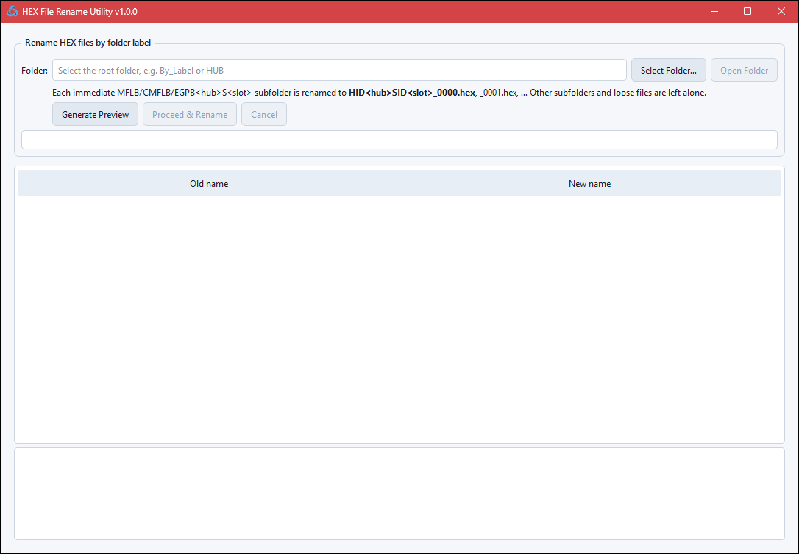
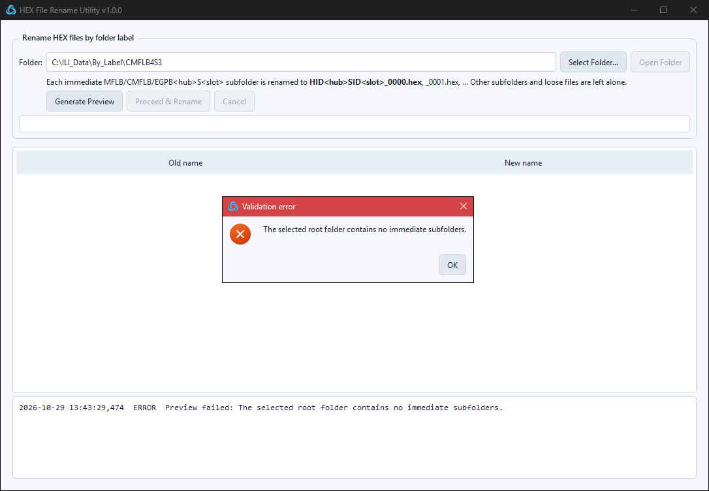
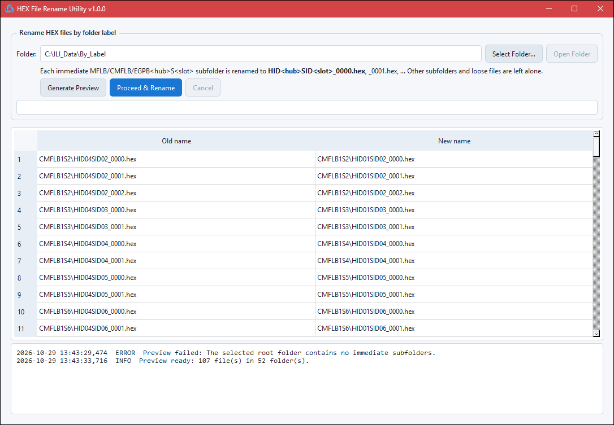
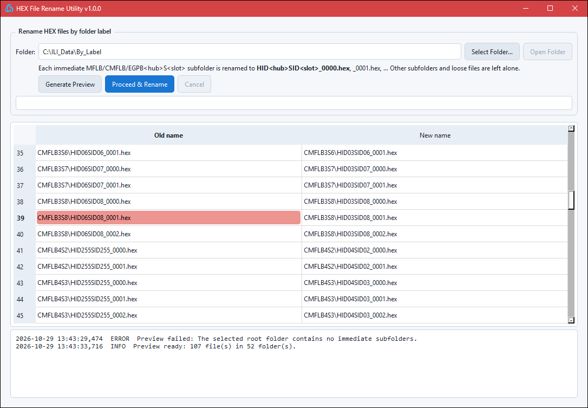
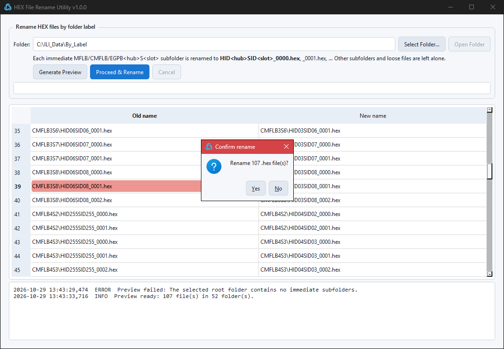
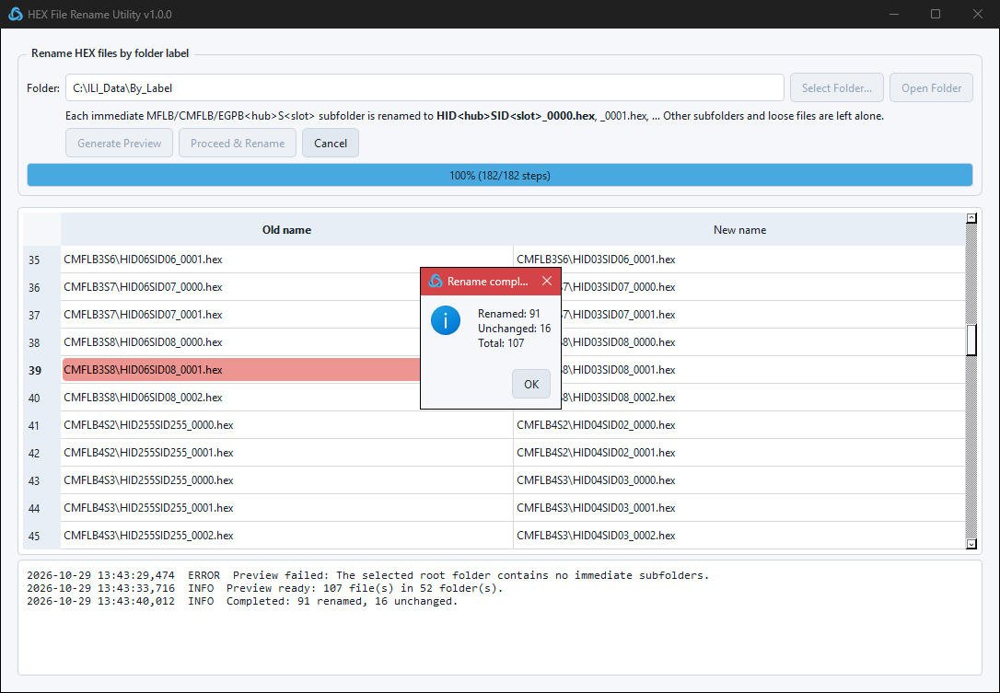
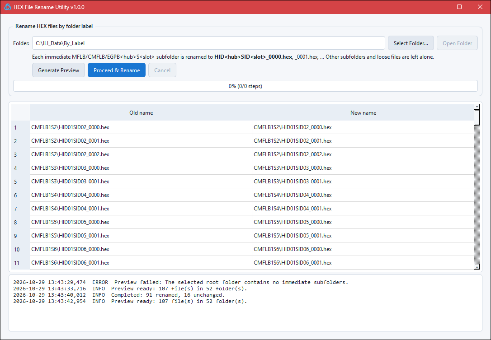

# HEX File Rename Utility: User Manual

**Version 1.0.0** · Windows 10 / 11 · single-file `RenameUtility.exe`, no install needed

This manual walks through a real job. The dataset is `By_Label_24inch_CMFL.zip` from a 24-inch CMFL run, extracted to `C:\ILI_Data\By_Label`. The dataset holds 52 sensor folders and 107 `.hex` files. 43 of those files still carry the factory name `HID255SID255_…`.

---

## 1. What the tool does

After a run, the sensor data is copied off the hub into one folder per sensor board. Each folder is named after the **label on the physical board**:

```text
By_Label\
├── CMFLB1S2\   HID04SID02_0000.hex  HID04SID02_0001.hex  HID04SID02_0002.hex
├── CMFLB4S2\   HID255SID255_0000.hex  HID255SID255_0001.hex        ← unnamed board
├── ...
├── INLB0000.hex                                                     ← loose file, ignored
└── ODO_0002.hex                                                     ← loose file, ignored
```

The file names come from the IDs stored on the board (`HID` = hub ID, `SID` = slot ID). On a board that was never configured, the IDs read `255`. On a board moved between hubs, the IDs are stale. **The folder label is the truth.** The tool renames every file to match the label of its folder:

| Folder (label) | Files before | Files after |
|---|---|---|
| `CMFLB4S2` | `HID255SID255_0000.hex`, `HID255SID255_0001.hex` | `HID04SID02_0000.hex`, `HID04SID02_0001.hex` |
| `CMFLB1S2` | `HID04SID02_0000.hex` … `_0002.hex` | `HID01SID02_0000.hex` … `_0002.hex` |
| `CMFLB2S2` | `HID02SID02_0000.hex`, `HID02SID02_0001.hex` | unchanged (already correct) |

### Naming rule

| Folder name pattern | Example | Output file names |
|---|---|---|
| `MFLB<hub>S<slot>` | `MFLB3S7` | `HID03SID07_0000.hex`, `_0001.hex`, … |
| `CMFLB<hub>S<slot>` | `CMFLB4S2` | `HID04SID02_0000.hex`, `_0001.hex`, … |
| `EGPB<hub>S<slot>` | `EGPB2S1` | `HID02SID01_0000.hex`, `_0001.hex`, … |

- Hub and slot numbers are zero-padded to two digits. Folder names are not case-sensitive.
- Only **immediate** subfolders of the selected root are processed, and only the `.hex` files directly inside them.
- Files are numbered from `0000` in natural sort order (`_2` comes before `_10`), so recording order is kept.
- Other subfolders are skipped with a warning in the log. Loose files in the root, such as `INLB0000.hex` and `ODO_0002.hex`, are left alone.

---

## 2. Starting the tool

1. Download `RenameUtility.exe` from the [latest release](https://github.com/Kinben-Electronics-Team/Rename_utility/releases/latest).
2. Double-click it. You do not need Python or Qt.
3. If Windows SmartScreen shows a warning, select **More info → Run anyway**. Do this only for a copy downloaded from the release page.



| Area | Purpose |
|---|---|
| **Folder** | The root folder that holds the sensor folders, for example `By_Label` or `HUB`. Type the path or use **Select Folder…**. |
| **Generate Preview** | Scans the folder and lists every planned rename. This button changes nothing on disk. |
| **Proceed & Rename** | Applies the preview. It is available only after a valid preview. |
| **Cancel** | Stops a running rename and rolls back every change made so far. |
| Progress bar | Shows rename progress. Each file takes two steps, described in [section 5](#5-safety). |
| Table | Shows each planned rename as `Old name → New name`, prefixed with the folder. |
| Log | Shows timestamped info, warnings (skipped folders) and errors. |

---

## 3. Renaming a dataset

### Step 1: Select the root folder

Select **Select Folder…** and choose the folder that **contains** the sensor folders, for example `C:\ILI_Data\By_Label`. Do not choose one sensor folder such as `CMFLB4S3`.

If you choose a sensor folder by mistake, the preview stops with an error. Nothing is changed:



### Step 2: Generate and review the preview

Select **Generate Preview**. The log confirms the scan, here *Preview ready: 107 file(s) in 52 folder(s)*:



Scroll through the table and check the result before going on. Rows 41 onward show the unnamed `HID255SID255` files from hub 4, each mapped to its label:



> **Check before you continue:** each folder label must match the board that recorded the data. The tool trusts the label completely.

### Step 3: Confirm the rename

Select **Proceed & Rename**. A confirmation shows the number of files. Select **Yes** to start or **No** to go back.



Before it starts, the tool scans the folders again. If any file or folder changed after the preview (added, removed, renamed or modified), the rename is refused with **Preview out of date**. Generate the preview again.

### Step 4: Done

A summary appears when the rename finishes. In this dataset, 91 files were renamed. The other 16 already had the correct name and were left as they were.



### Running it again

Running the tool again on the same folder is safe. Every `Old name` now equals its `New name`, and a second rename changes nothing (all files *Unchanged*).



---

## 4. Messages and troubleshooting

| Message | Cause | Fix |
|---|---|---|
| *Invalid folder: Select a valid folder first.* | The **Folder** field is empty or the path does not exist. | Select the folder again. |
| *The selected root folder contains no immediate subfolders.* | You selected one sensor folder, not the root. | Select the parent folder, for example `By_Label`. |
| *No eligible .hex files were found in valid immediate MFLB/CMFLB/EGPB subfolders.* | No subfolder matches the naming pattern, or every match is empty. | Check the folder names, for example `CMFLB4S2`, not `CMFL B4 S2` or `CMFLB4S2_old`. |
| Log: *Skipped unrelated subfolder: …* | A subfolder name does not match the pattern. | No action is needed if that is expected. Otherwise, correct the folder name. |
| Log: *Skipped empty subfolder …* | The folder matches the pattern but has no `.hex` files. | Check that the data was copied. |
| *Subfolder 'X': Target names already exist* | A non-`.hex` item in the folder already uses a target name. | Move that item out of the folder. |
| *Preview out of date* | Something on disk changed after the preview. | Select **Generate Preview** again. |
| *Rename failed … All completed changes were rolled back.* | A file was locked (for example, open in another program) or the drive was removed. | Close the program that holds the file and try again. The data is back as it was. |
| *Rollback incomplete. Manual recovery is required* | A rollback step failed too. This is very unlikely. | The message lists every `.__renametmp_….tmp` file and its original name. Rename those files back by hand. |

---

## 5. Safety

- **The preview never changes anything.** Files change only after you confirm.
- **The batch is all-or-nothing.** Every file is first moved to a temporary name, then to its final name. If any step fails or you select **Cancel**, every completed step is undone in reverse order.
- **Collisions are refused before anything moves.** The tool checks for duplicate or existing target names first.
- **Stale previews are rejected.** File names, sizes and timestamps are checked again before the rename runs.
- **Correct files are left alone.** Files that already have the right name are not touched.
- File contents are never opened or modified. Only names change.

> Keep the original zip or a backup of field data until the renamed set has been checked in the analysis software.
